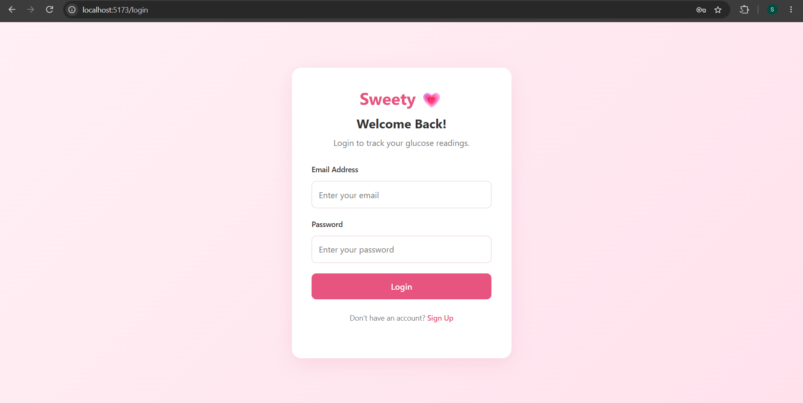
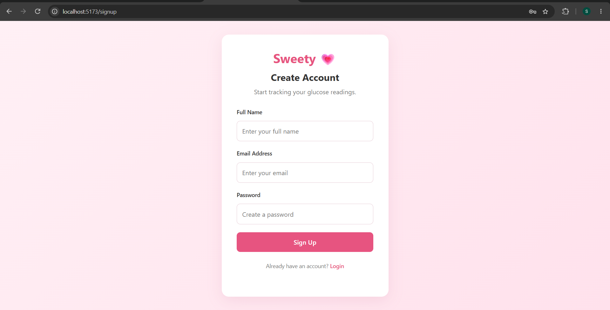
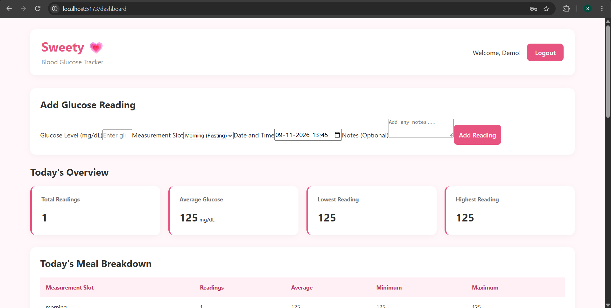
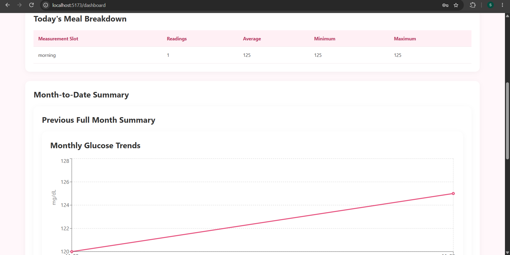
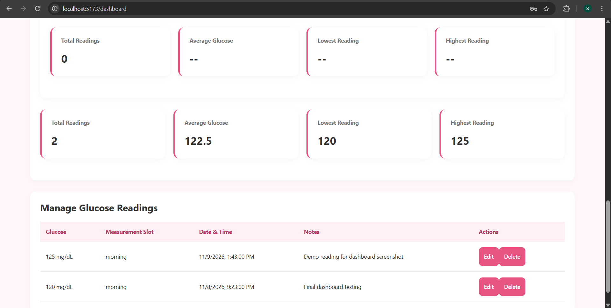

# Sweety 💗 – Blood Glucose Tracker

A full-stack web application to record, manage, and monitor blood glucose readings with daily and monthly reports.

## 📌 About the Project

Sweety is a Blood Glucose Tracker built using React.js, Node.js, Express.js, and PostgreSQL. It allows users to securely register, log in, record glucose readings, manage their entries, and view glucose trends through an interactive dashboard.

## ✨ Features

- User registration and login
- Secure password hashing using bcrypt
- JWT-based authentication
- Protected routes and user-specific data
- Add, view, update, and delete glucose readings
- Glucose validation (40–600 mg/dL)
- Four measurement slots:
  - Morning (Fasting)
  - After Breakfast
  - After Lunch
  - After Dinner
- Prevent duplicate readings for the same measurement slot and day
- Daily glucose summary
- Month-to-date report
- Previous full month report
- Average, minimum, and maximum glucose statistics
- Interactive glucose trend chart
- Responsive user dashboard
- Empty-state handling

## 🛠️ Tech Stack

**Frontend**
- React.js
- Vite
- React Router
- Axios
- Recharts
- CSS

**Backend**
- Node.js
- Express.js
- JSON Web Token (JWT)
- bcrypt
- REST API

**Database**
- PostgreSQL

**Development Tools**
- Visual Studio Code
- Postman
- Git and GitHub

## 📂 Project Structure

```text
Sweety-glucose-tracker/
│
├── client/
│   ├── src/
│   │   ├── components/
│   │   │   ├── AddReading.jsx
│   │   │   ├── ReadingList.jsx
│   │   │   └── GlucoseChart.jsx
│   │   ├── context/
│   │   │   └── AuthContext.jsx
│   │   ├── pages/
│   │   │   ├── Login.jsx
│   │   │   ├── Signup.jsx
│   │   │   └── Dashboard.jsx
│   │   ├── services/
│   │   │   ├── api.js
│   │   │   ├── authService.js
│   │   │   ├── readingService.js
│   │   │   └── reportService.js
│   │   ├── App.jsx
│   │   ├── App.css
│   │   ├── index.css
│   │   └── main.jsx
│   └── package.json
│
├── server/
│   ├── config/
│   ├── controllers/
│   ├── middleware/
│   ├── models/
│   ├── routes/
│   ├── scripts/
│   ├── index.js
│   └── package.json
│
├── .env.example
├── .gitignore
└── README.md
```

## ⚙️ Installation and Setup

### 1. Clone the Repository

```bash
git clone https://github.com/Shrishti1925/Sweety-Glucose-Tracker.git
cd Sweety-glucose-tracker
```

### 2. Backend Setup

```bash
cd server
npm install
```

Create a `.env` file inside the server folder.

Configure the following environment variables:

```env
PORT=5000
DB_HOST=127.0.0.1
DB_PORT=5432
DB_NAME=sweety_glucose_db
DB_USER=postgres
DB_PASSWORD=your_postgres_password
JWT_SECRET=your_secure_jwt_secret
```

Use your own local database password and a strong JWT secret. Never commit `.env` to GitHub.

### 3. Database Setup

Install PostgreSQL and create a database named:

```sql
CREATE DATABASE sweety_glucose_db;
```

Initialize the database schema:

```bash
npm run init-db
```

### 4. Start the Backend

```bash
npm run dev
```

Backend runs at:

```text
http://localhost:5000
```

Health check:

```text
http://localhost:5000/api/health
```

### 5. Frontend Setup

Open another terminal:

```bash
cd client
npm install
npm run dev
```

Open the application:

```text
http://localhost:5173
```

## 🔗 API Endpoints

### Authentication

| Method | Endpoint | Description |
|---|---|---|
| POST | `/api/auth/register` | Register a user |
| POST | `/api/auth/login` | Login |
| GET | `/api/auth/profile` | Get user profile |

### Glucose Readings

| Method | Endpoint | Description |
|---|---|---|
| POST | `/api/readings` | Add a reading |
| GET | `/api/readings` | Get all readings |
| GET | `/api/readings/:id` | Get a reading |
| PUT | `/api/readings/:id` | Update a reading |
| DELETE | `/api/readings/:id` | Delete a reading |

### Reports

| Method | Endpoint | Description |
|---|---|---|
| GET | `/api/reports/daily` | Daily report |
| GET | `/api/reports/monthly` | Monthly report |
| GET | `/api/reports/periods` | Month-to-date and previous full month |

Protected endpoints require a valid JWT Bearer token.

## 🧪 Validation Rules

- Glucose readings must be integers between 40 and 600 mg/dL.
- Only the four supported measurement slots are accepted.
- One reading is allowed per measurement slot per day for each user.
- Future measurement dates are not allowed.
- Notes are limited to 500 characters.
- Users can access only their own glucose readings.

## 📊 Dashboard

The dashboard provides:
- Today's glucose overview
- Meal-wise reading breakdown
- Month-to-date statistics
- Previous full month statistics
- Monthly glucose trend visualization
- Reading management

## 🔒 Security

- Passwords are hashed using bcrypt.
- JWT authentication protects private API routes.
- User-specific database queries enforce data isolation.
- Environment secrets are excluded from version control.

## 🚀 Future Improvements

- Pagination and advanced filtering
- Doctor and patient roles
- Automated testing
- Docker deployment
- Improved chart visualizations
- Cloud deployment

## ⚠️ Disclaimer

Sweety is an educational glucose tracking application. It is not a medical device and does not provide medical diagnosis or treatment recommendations. Use demo data for testing and consult qualified healthcare professionals for medical advice.

## 👩‍💻 Author

**Shrishti Singh**

B.Tech – Information Technology

[GitHub](https://github.com/Shrishti1925)

[LinkedIn](https://www.linkedin.com/in/shrishti-singh-2b5926273/)

## Seed Database

To create a demo account and populate the database with sample glucose readings, run:

```bash
cd server
node scripts/seed.js
```

**Demo login credentials:**

- Email: `demo@sweety.com`
- Password: `Demo@123456`

The seed script creates or updates the demo account and inserts five sample glucose readings. Running it again resets only the demo account's readings.

## Notes / Assumptions

- This application is an educational glucose tracking project and is not a medical device.
- Glucose readings are stored in `mg/dL`.
- Valid glucose values are integers between 40 and 600.
- Each user can record one reading for each of the four measurement slots per day.
- Measurement dates and daily report boundaries use the `Asia/Kolkata` timezone.
- Each user's readings and reports are isolated using authenticated user IDs.
- The demo account is intended only for testing. Do not use real patient or medical information.

## 🚀 Future Improvements

- Pagination and advanced filtering
- Doctor and patient roles
- Docker deployment
- Improved chart visualizations
- Cloud deployment
- Automated frontend tests

## Running Automated Tests

The backend uses Jest and Supertest for API testing.

Run the tests from the `server` directory:

```bash
npm test
```

The test suite covers:
- Health check endpoint
- Registration and login validation
- JWT authentication middleware
- Glucose reading validation
- Report query parameter validation
- Undefined API routes

**Latest test result:** 18 tests passed.

## 📸 Application Screenshots

### Login Page


### Signup Page


### Dashboard




